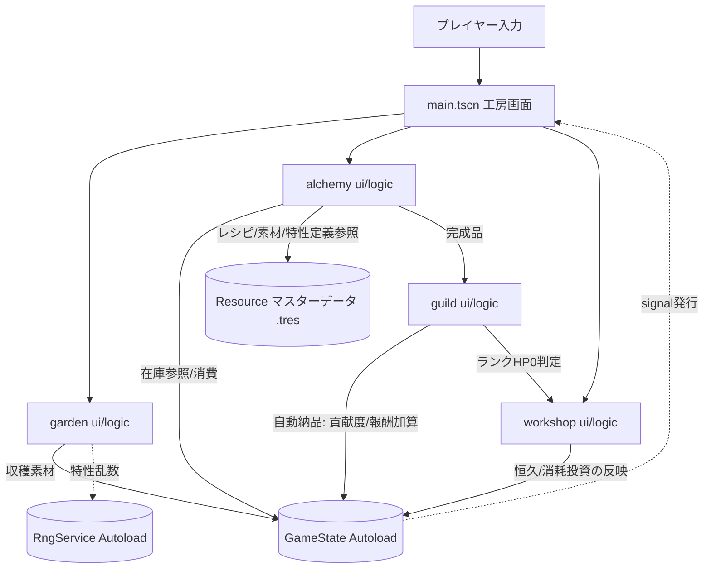

# atelier-alchemy-core アーキテクチャ設計

**作成日**: 2026-07-09
**関連要件定義**: [requirements.md](../../spec/atelier-alchemy-core/requirements.md)
**ヒアリング記録**: [design-interview.md](design-interview.md)

**【信頼性レベル凡例】**:
- 🔵 **青信号**: 要件定義書・ヒアリングを参考にした確実な設計
- 🟡 **黄信号**: 要件定義書・ヒアリングから妥当な推測による設計
- 🔴 **赤信号**: 要件定義書・ヒアリングにない推測による設計

---

## ✅ 技術スタック変更（確定事項）

**本設計は技術スタックを Phaser 3 + TypeScript（現行 `atelier-guild-rank`）から Godot 4.x + GDScript へ変更する方針で作成しており、2026-07-09 のレビューでユーザーにより正式に確定されました。**

- ヒアリングで「Godot Engineで検討」「GDScript」「本格検討」の回答を得て設計し、その後の赤信号・黄信号レビューで正式採用が確定しました 🔵 *design-interview.md Q2, Q2-1, Q2-2、および本書レビュー時のユーザー確定より*
- これは現行 `CLAUDE.md`（「atelier-guild-rank/: Phaser 3 + TypeScript版（メイン開発・pnpmモノレポ構成）」）の記載と異なるため、**`CLAUDE.md` の更新が別タスクとして必要**です（本書では未実施。タスク分割フェーズで対応すること） 🔵
- 現行 `atelier-guild-rank`（Phaser3+TS）は継続開発しない。本システムは新規Godotプロジェクトとして構築する 🔵

## システム概要 🔵

**信頼性**: 🔵 *要件定義書 概要・機能要件より*

「アトリエ錬金術ゲーム」v7.0（調合主軸モデル）のコアシステムを実装するアプリケーション。
庭（仕込み層）・調合（主戦場）・ギルド納品（決算）・工房強化（金の使い道）・ランク進行の5システムから成る、
シングルプレイヤー・ローカル完結のターン制デッキ／リソース管理ゲーム。

## アーキテクチャパターン

### 基本方針 🟡

**信頼性**: 🟡 *既存プロジェクト（`atelier-guild-rank`）のFeature-Based Architecture / Functional Core,Imperative Shellの原則をGodotの慣用構造に翻訳した設計*

現行TypeScript版で採用している以下2つの原則は、エンジンを変えても有効な設計原則のため踏襲します。

1. **Feature-Based Architecture**: 機能（庭・調合・納品・工房強化・ランク）単位でディレクトリを分割する
2. **Functional Core, Imperative Shell**: 計算ロジック（品質計算・貢献度計算・特性発現判定等）を副作用のない純粋関数として分離し、Node/シーンからの呼び出しに限定する

### Godotにおける実装方針 🟡

**信頼性**: 🟡 *Godot公式ドキュメント（Autoloads, Resources, Scene Organization）から本プロジェクトの要件に合わせて設計*

| TypeScript版の概念 | Godotでの対応 |
|---|---|
| `StateManager`（DIコンテナ経由のシングルトン） | `GameState` Autoload（シングルトンNode） |
| `EventBus`（Pub/Sub） | Godotネイティブの `signal`。`GameState` や各サービスNodeが自身の状態変化をsignalで発行し、UIがconnectして購読する（現行のような専用EventBus Autoloadは持たず、Godotの標準機能に委譲） |
| `features/{feature}/services/`（純粋関数） | `res://features/{feature}/logic/*.gd`（`class_name`付き `RefCounted` またはstatic関数を持つクラス。Nodeを継承しない） |
| `features/{feature}/components/`（UI） | `res://features/{feature}/ui/*.tscn` + `*.gd`（Control/Node2Dベースのシーン） |
| GAME_CONFIG / THEME（定数） | `res://shared/constants/game_balance.gd`（static定数クラス）／`res://shared/theme/theme.gd` |
| マスターデータ（素材・レシピ・特性の定義） | カスタム `Resource`（`class_name` + `.tres`ファイル）。コード変更なしにデータ調整可能 |
| DIコンテナ経由のサービス解決 | Autoloadの直接参照（Godotの慣習として過度なDIは行わず、Autoloadで十分薄く済ませる） |

## コンポーネント構成

### ディレクトリ構造（案） 🟡

**信頼性**: 🟡 *Feature-Based Architectureの原則をGodotプロジェクト構造に適用した推測*

```
atelier-godot/                      # 新規Godotプロジェクト（現行 atelier-guild-rank/ とは別ルート）
├── project.godot
├── autoload/
│   ├── game_state.gd              # ランHP・ターン数・ゴールド・在庫等の状態管理
│   └── rng_service.gd             # シード管理付き乱数生成（庭の特性抽選等）
├── features/
│   ├── garden/                    # ① 庭（仕込み層）
│   │   ├── logic/
│   │   │   ├── growth_calculator.gd     # 純粋関数: 成熟判定・枯死判定
│   │   │   └── trait_roll.gd            # 純粋関数: 特性乱数付与（分散のみ）
│   │   ├── ui/
│   │   │   ├── garden_panel.tscn
│   │   │   └── garden_slot.tscn
│   │   └── data/
│   │       └── seed_definition.gd       # Resource: 種の定義（成熟ターン数等）
│   ├── alchemy/                   # ② 調合（主戦場・核心）
│   │   ├── logic/
│   │   │   ├── quality_calculator.gd    # 純粋関数: 品質＝平均値計算
│   │   │   ├── trait_activation.gd      # 純粋関数: 閾値発現判定（同一特性2個以上）
│   │   │   └── value_calculator.gd      # 純粋関数: 貢献度/報酬の算出式
│   │   ├── ui/
│   │   │   ├── alchemy_bench.tscn       # 投入枠UI
│   │   │   └── material_slot.tscn
│   │   └── data/
│   │       ├── material_definition.gd   # Resource: 素材（品質・特性タグ）
│   │       ├── trait_definition.gd      # Resource: 特性タグ（貢献度系/報酬系/補助系）
│   │       └── recipe_definition.gd     # Resource: レシピ（投入枠数等）
│   ├── guild/                     # ③ ギルド納品（決算）
│   │   ├── logic/
│   │   │   └── delivery_calculator.gd   # 純粋関数: 指定合致ボーナス判定
│   │   ├── ui/
│   │   │   └── daily_request_banner.tscn # 日替わり指定調合物の表示
│   │   └── data/
│   │       └── rank_definition.gd       # Resource: ランクHP・制限ターン数
│   ├── workshop/                  # ④ 金の使い道・工房強化
│   │   ├── logic/
│   │   │   └── upgrade_cost_table.gd    # 純粋関数/定数: 価格序列
│   │   ├── ui/
│   │   │   ├── permanent_upgrade_screen.tscn  # ランク間・恒久投資
│   │   │   └── consumable_shop_panel.tscn     # ターン中・消耗投資
│   │   └── data/
│   │       └── upgrade_definition.gd
│   └── prototype/                 # ⑤ 1画面プロトタイプ（REQ-501〜503）
│       └── ui/
│           └── alchemy_prototype.tscn   # 庭・時間経過はダミー、調合のみ検証
├── shared/
│   ├── constants/
│   │   └── game_balance.gd        # バランス数値（TBD値を含む。GAME_CONFIG相当）
│   └── theme/
│       └── theme.gd               # 色・フォント等（THEME相当）
├── scenes/
│   └── main.tscn                  # 工房画面（庭・調合・ショップへの導線を持つメイン画面）
└── tests/
    └── unit/
        └── features/              # GUT等によるFunctional Coreのユニットテスト
```

### レイヤー別の責務

#### Functional Core（`logic/`）🔵

**信頼性**: 🔵 *要件定義書REQ-105, REQ-106, REQ-109〜REQ-112, REQ-115の計算式より*

- `class_name` 付きの **`static func` のみで構成するクラス**とし、Nodeは継承しない（Godotアーキテクトレビューにより「RefCountedかstaticか曖昧」との指摘を受け、純粋関数はインスタンス化不要な`static func`に統一。2026-07-09修正）
- 副作用なし、同じ入力に対して常に同じ出力。**ランク等の外部状態はAutoload参照ではなく必ず引数で受け取る**（下記の理由により2026-07-09修正）
- 例: `QualityCalculator.calculate_base_quality(materials: Array[MaterialInstance]) -> int`（REQ-105の基礎品質）
- 例: `TraitActivation.resolve_activated_traits(materials: Array[MaterialInstance], reveal_level: int) -> Array[TraitDefinition]`
  - **修正（2026-07-09、Godotアーキテクトレビュー Critical#1対応）**: 段階的開示（REQ-121〜124）はランク依存だが、関数内で`GameState.current_rank`を参照すると純粋関数の「入力のみに依存」原則に違反する。そのため`reveal_level`（段階的開示レベル）を**明示的な引数**として渡す設計に修正した。呼び出し側（Imperative Shell）が`GameState.current_rank.trait_reveal_level`を読み取って渡す
  - 同一系統内での複数特性同時発現（REQ-112）、貢献度系/報酬系をまたぐ排他制御（REQ-115）もこの関数の責務
- 例: `QualityCalculator.apply_trait_penalty(base_quality: int, activated_traits: Array[TraitDefinition]) -> int`（REQ-111の品質ペナルティ。最終品質を算出）
- 例: `AlchemyResolver.craft(materials: Array[MaterialInstance], reveal_level: int, daily_request: DailyRequest) -> CraftResult`
  - **新設（2026-07-09、Godotアーキテクトレビュー Warning#2対応）**: 品質計算・特性発現・ペナルティ適用・貢献度/報酬算出の一連の計算を**1つの純粋関数に束ねる「調合オーケストレーター」**。詳細は下記Imperative Shellの項、および[dataflow.md](dataflow.md)を参照
- GUT（Godot Unit Test）等でNode/シーンなしに単体テスト可能（ランクをNode経由で参照しないため、テストではシーン起動なしに`reveal_level`を直接渡してテストできる）

#### Imperative Shell（`ui/`, `autoload/`）🟡

**信頼性**: 🟡 *Godotのシーン/Autoloadパターンから妥当な推測*

- シーン（`.tscn`）・Autoloadシングルトンが担当
- `GameState` Autoloadへの状態問い合わせ・更新、UIのシグナル購読、入力処理
- **修正（2026-07-09、Godotアーキテクトレビュー Warning#2対応）**: UI（`AlchemyBench`）が `QualityCalculator` → `TraitActivation` → `ValueCalculator` を個別に直接呼び出す設計は、調合ワークフローというビジネスロジックがUIに漏れ「UIはビジネスロジックを持たない」という原則に反していた。修正後は `GameState.craft(materials)` メソッド（内部で `AlchemyResolver.craft(...)` という単一の純粋関数を呼ぶ）に処理を集約し、UIは投入枠の選択操作と、結果を受け取るsignal購読のみを行う
- Functional Coreの呼び出し結果をUIに反映するのみで、ビジネスロジックを持たない

### マスターデータ設計（`data/`）🔵

**信頼性**: 🔵 *要件定義書の素材・特性・レシピ・ランクの構造（REQ-103, REQ-104, REQ-107, REQ-401等）より*

現行TypeScript版のJSON/TSマスターデータに相当する部分は、Godotのカスタム `Resource` として実装します。
`.tres`（テキスト形式リソース）でエディタから編集可能にし、コード変更なしにバランス調整ができるようにします（Godot公式の推奨パターン）。

詳細な型定義は [data-model.md](data-model.md) を参照してください。

## システム構成図 🟡

**信頼性**: 🟡 *要件定義書のメインループ（庭→調合→納品→ランク進行→工房強化）より構成*



## 非機能要件の実現方法

### パフォーマンス 🟡

**信頼性**: 🟡 *NFR-001（ターン制、厳密なFPS要件なし）から妥当な推測*

- ターン制ゲームのためリアルタイム性能要件は低い。Godotのデフォルトのシーンツリー処理で十分
- マスターデータ（`Resource`）はロード時に一括読み込みし、実行中の動的ファイルI/Oを避ける

### セキュリティ 🔵

**信頼性**: 🔵 *NFR-101（ローカル完結、外部通信なし）より*

- ネットワーク通信を行わない。Godotの `HTTPRequest` 等のノードは使用しない
- 外部への機密情報送信のリスクなし（セーブ機能自体がスコープ外のため、ローカルファイルへの入出力も本設計には含まれない）

### ユーザビリティ 🔵

**信頼性**: 🔵 *NFR-201, NFR-202（段階的開示）より*

- ランク（`RankDefinition.reveal_level` 等）に応じて、UI（`alchemy_bench.tscn`）が特性タグの表示/非表示を切り替える
- Functional Core側（`TraitActivation`）もランクに応じて発現判定自体を無効化する（REQ-121: Gランクは特性を一切発現させない）ため、UI側の表示制御だけに依存しない二重の安全策とする 🟡

## 技術的制約

### エンジン・言語制約 🔵

**信頼性**: 🔵 *2026-07-09 ユーザー確定事項*

- Godot 4.x系（GDScript）を前提とする。具体的なマイナーバージョンは実装着手時の最新安定版を採用すること
- GDScriptは動的型付け言語だが、`class_name` と型ヒント（`-> int` 等）を必須とし、TypeScript版の「`any`禁止・戻り値型明示」の思想を可能な範囲で踏襲する 🟡

### 既存資産との関係 🔵

**信頼性**: 🔵 *note.md「資産再利用」・ヒアリングQ2-2より*

- 現行 `atelier-guild-rank`（Phaser3+TS）の `calculateQuality` 等のロジックはそのまま移植できない（言語が異なるため）が、**計算式・アルゴリズムの仕様としては本設計の `logic/*.gd` に翻訳移植する**
- 依頼・採取・庭配置パズル等、v7.0で廃止された旧システムのコードは参照しない（要件定義ヒアリングQ3の方針を継続）

### スコープ外（確定事項）🔵

**信頼性**: 🔵 *2026-07-09 ユーザー確定事項*

- セーブ/ロード機能は本設計に含まない（ヒアリングQ3）。将来的に追加する場合は `GameState` の状態をシリアライズするResourceベースの設計を追加検討する
- タイトル画面・設定画面等の周辺機能は本要件定義・本設計のスコープに含めない（確定）
- **残タスク**: Godot採用に伴う `CLAUDE.md` の更新（技術スタック記載の書き換え）は未実施。タスク分割フェーズ（`/tsumiki:kairo-tasks`）で対応すること

## 関連文書

- **データフロー**: [dataflow.md](dataflow.md)
- **データモデル**: [data-model.md](data-model.md)
- **要件定義**: [requirements.md](../../spec/atelier-alchemy-core/requirements.md)

## 信頼性レベルサマリー

- 🔵 青信号: 11件 (58%)
- 🟡 黄信号: 8件 (42%)
- 🔴 赤信号: 0件 (0%)

**品質評価**: 高品質（2026-07-09時点、更新後）。技術スタック変更（Godot採用）はユーザーにより正式に確定済み。残る🟡は「Godotでどう実装するか」という公式ドキュメントに基づく妥当な技術的翻訳であり、実装フェーズで詳細化する想定。数値TBD項目は引き続き `balance-tuning-cycle` 等での確定が必要。
