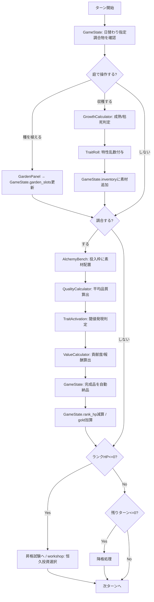
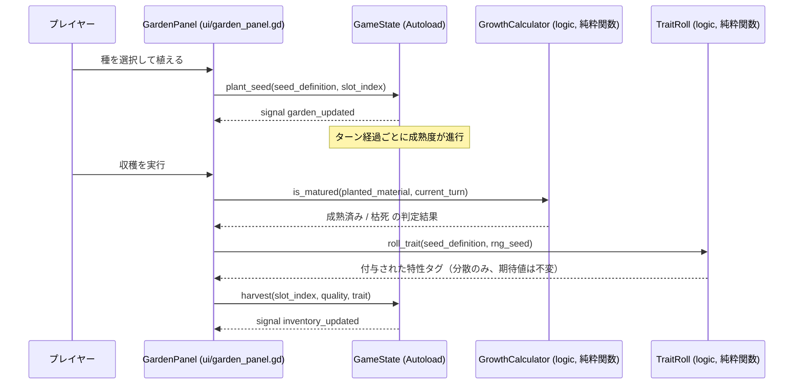
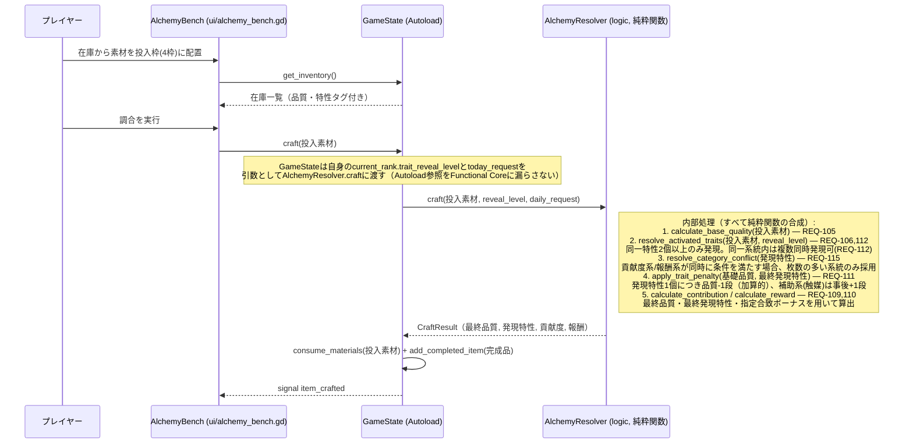
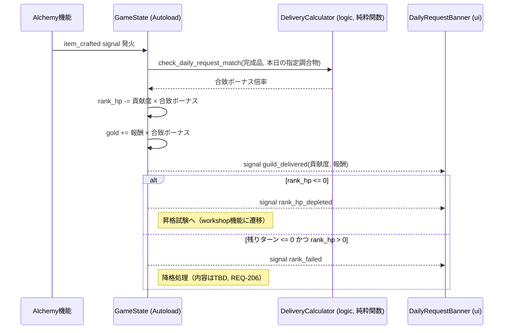
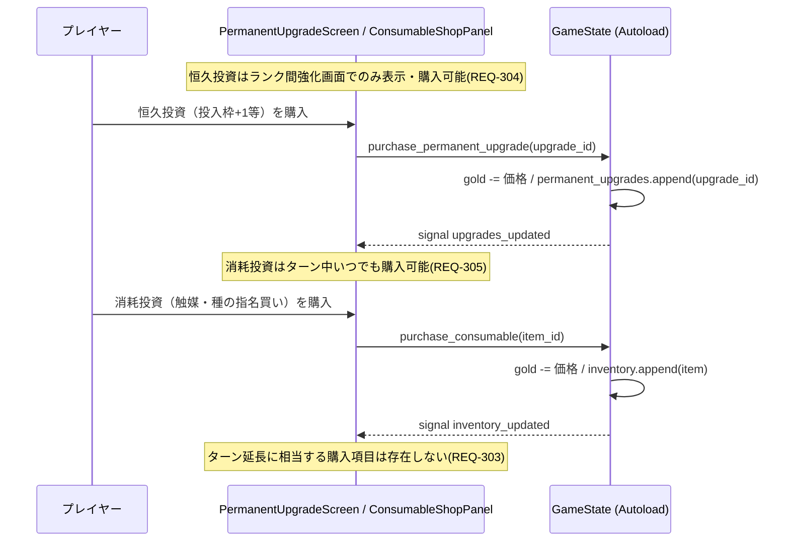
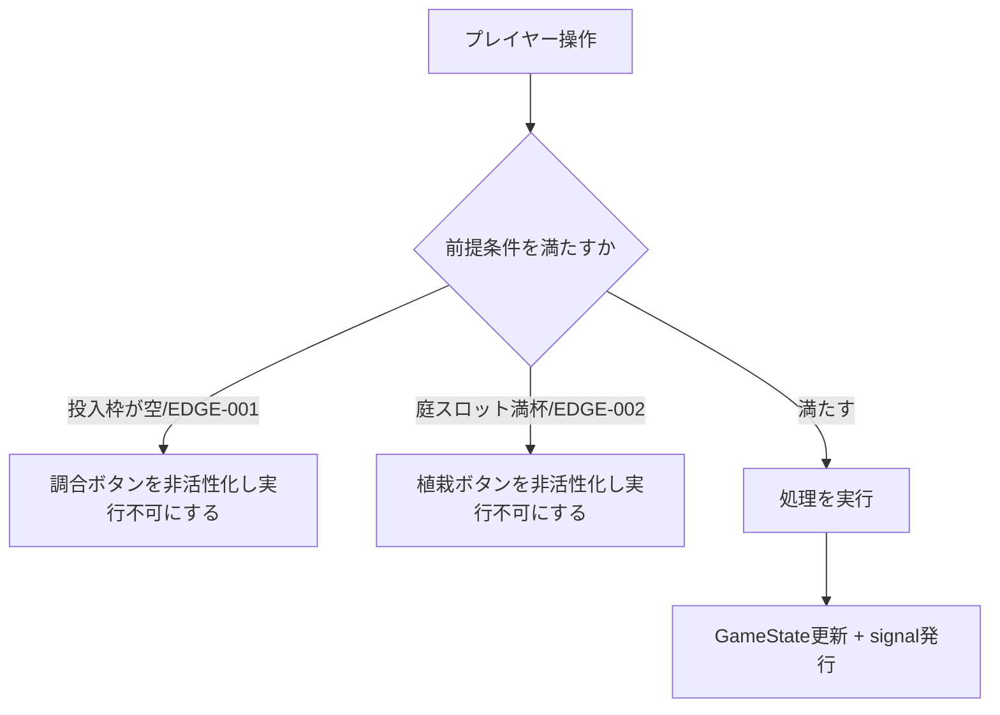

# atelier-alchemy-core データフロー図

**作成日**: 2026-07-09
**関連アーキテクチャ**: [architecture.md](architecture.md)
**関連要件定義**: [requirements.md](../../spec/atelier-alchemy-core/requirements.md)

**【信頼性レベル凡例】**:
- 🔵 **青信号**: 要件定義書・ヒアリングを参考にした確実なフロー
- 🟡 **黄信号**: 要件定義書・ヒアリングから妥当な推測によるフロー
- 🔴 **赤信号**: 要件定義書・ヒアリングにない推測によるフロー

---

## システム全体のデータフロー（1ターンの流れ） 🟡

**信頼性**: 🟡 *要件定義書のメインループ（庭→調合→納品→ランク進行）をGodotのシーン/Autoload構成に翻訳*

## 主要機能のデータフロー

### 機能1: 庭での仕込み〜収穫 🔵

**信頼性**: 🔵 *ユーザーストーリー1.1, 1.2・要件REQ-001〜REQ-008より*

**関連要件**: REQ-001, REQ-004, REQ-005, REQ-006, REQ-007

### 機能2: 調合（投入枠への配置〜完成品生成）★核心 🔵

**信頼性**: 🔵 *ユーザーストーリー2.1, 2.2・要件REQ-101〜REQ-112, REQ-115より*

**関連要件**: REQ-105, REQ-106, REQ-109, REQ-110, REQ-111, REQ-112, REQ-115

**2026-07-09修正（Godotアーキテクトレビュー Warning#2対応）**: UIが計算ロジック（品質・特性・数値算出）を個別に直接オーケストレーションする旧設計は、ビジネスロジックのUI漏れを招くため、`GameState.craft()`（内部で純粋関数`AlchemyResolver.craft()`を1回呼ぶだけ）に処理を集約する設計へ変更した。

### 機能3: ギルド納品（自動）〜ランク判定 🔵

**信頼性**: 🔵 *ユーザーストーリー3.1, 3.2, 3.3・要件REQ-201〜REQ-206より*

**関連要件**: REQ-201, REQ-202, REQ-203, REQ-204, REQ-205, REQ-206

### 機能4: 工房強化（恒久投資・消耗投資） 🔵

**信頼性**: 🔵 *ユーザーストーリー4.1, 4.2, 4.3・要件REQ-301〜REQ-306より*

**関連要件**: REQ-301, REQ-302, REQ-303, REQ-304, REQ-305

## データ処理パターン

### 同期処理のみ 🔵

**信頼性**: 🔵 *ローカル完結・ターン制ゲームという性質より*

本ゲームは外部通信・非同期I/Oを持たないため、全ての処理は同期的な関数呼び出し（Functional Coreの純粋関数呼び出し）とGodotのsignalによる即時通知で完結します。バッチ処理・非同期処理・キャッシュ戦略は不要です。

### 状態変更の通知パターン 🟡

**信頼性**: 🟡 *Godot公式のsignalパターン（Connect to a Signal for Event Response）から妥当な推測*

- `GameState` は自身の状態を変更するメソッド（`plant_seed`, `harvest`, `consume_materials` 等）の末尾で対応するsignalを`emit()`する
- UIシーンは `_ready()` 内で `GameState.xxx_updated.connect(_on_xxx_updated)` のように購読する
- 現行TypeScript版のような専用`EventBus` Autoloadは設けず、Godotのネイティブsignalに一本化する（アーキテクチャ簡素化のための意図的な設計判断）

## エラーハンドリングフロー 🟡

**信頼性**: 🟡 *EDGE-001, EDGE-002（既存実装パターン・要件の妥当な推測）より*

- 本ゲームはユーザー入力エラー（不正な値の直接入力等）を持たないUI操作前提のため、例外的なエラー処理よりも「実行不可能な操作はそもそもUI上で選択させない」という予防的設計を基本方針とします 🟡

## 関連文書

- **アーキテクチャ**: [architecture.md](architecture.md)
- **データモデル**: [data-model.md](data-model.md)
- **要件定義**: [requirements.md](../../spec/atelier-alchemy-core/requirements.md)

## 信頼性レベルサマリー

- 🔵 青信号: 6件 (55%)
- 🟡 黄信号: 5件 (45%)
- 🔴 赤信号: 0件 (0%)

**品質評価**: 高品質（要件定義書のメインループが詳細なため、フロー自体は🔵中心。Godot固有の実装パターン部分のみ🟡）
