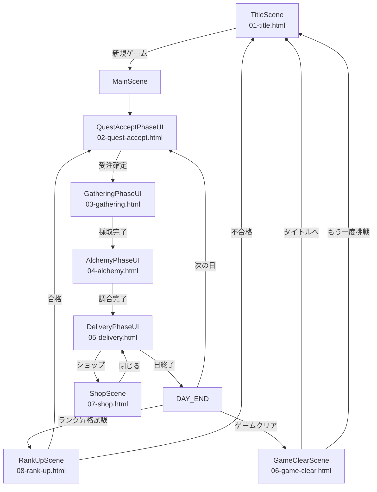
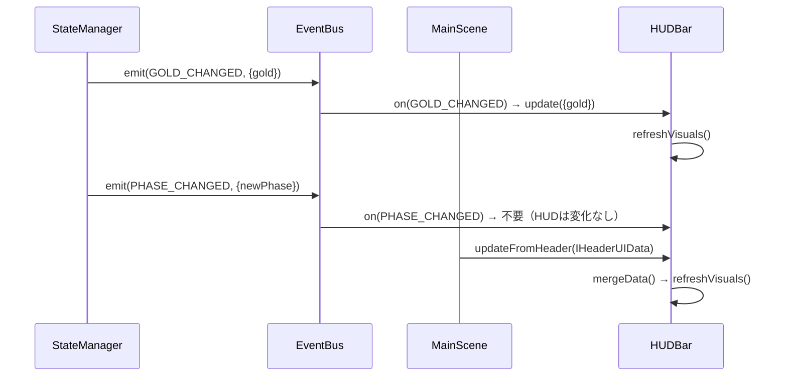
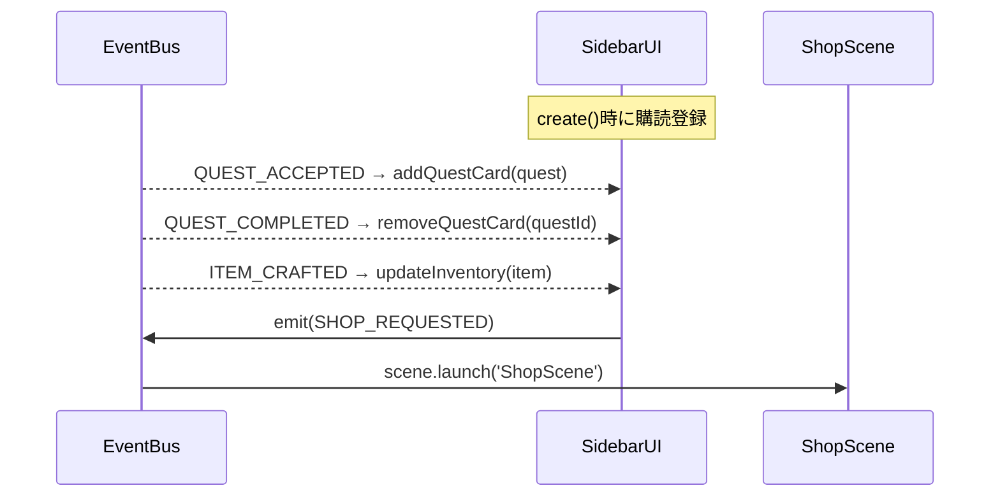
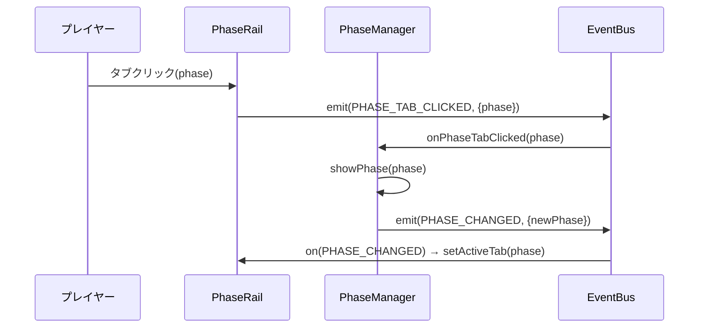
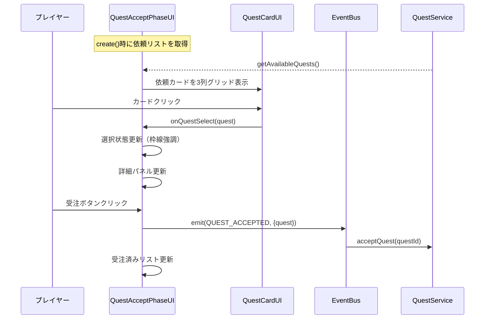
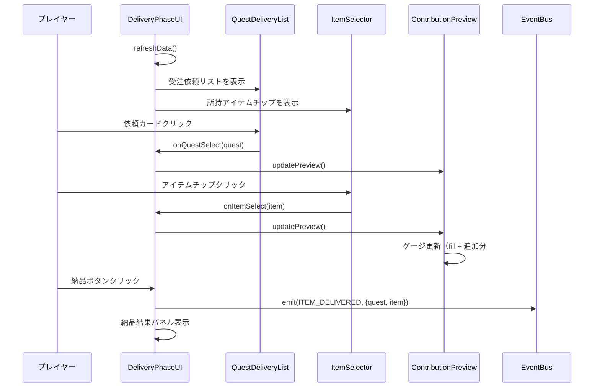
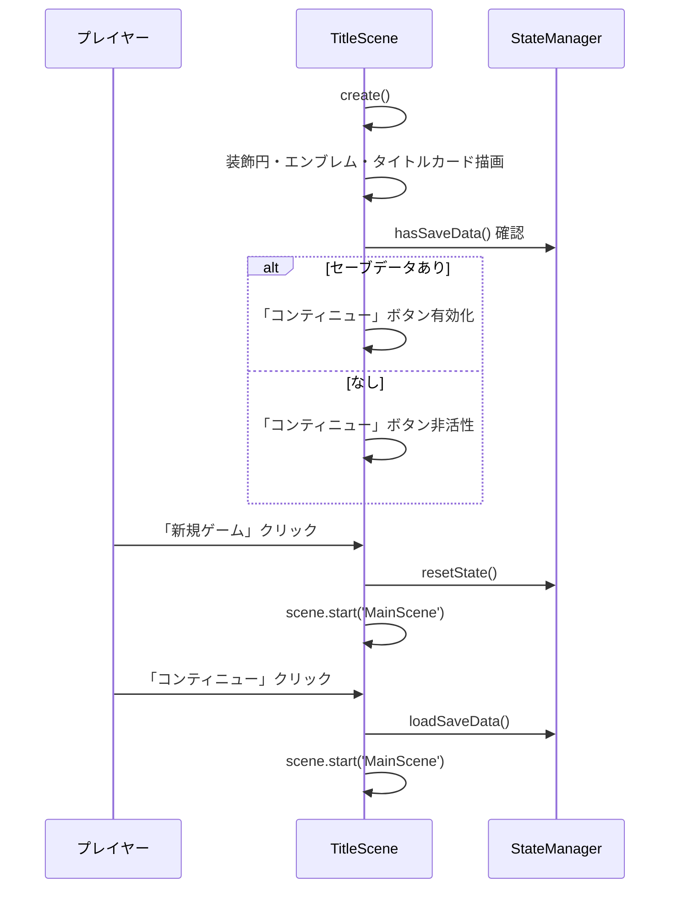
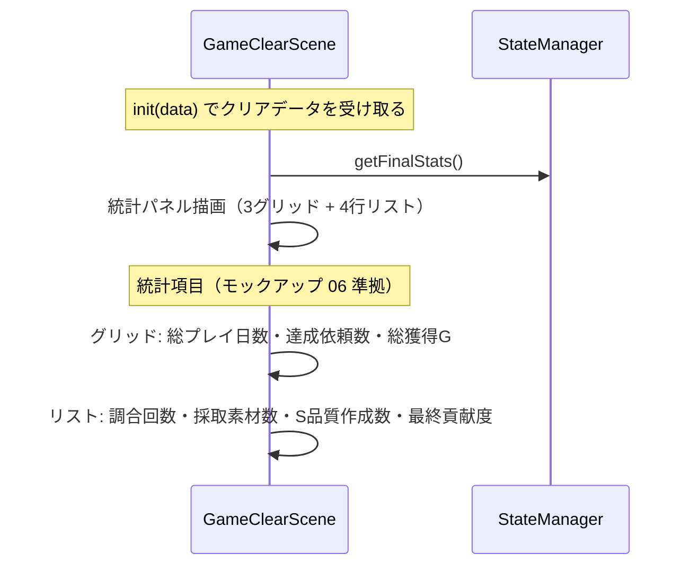
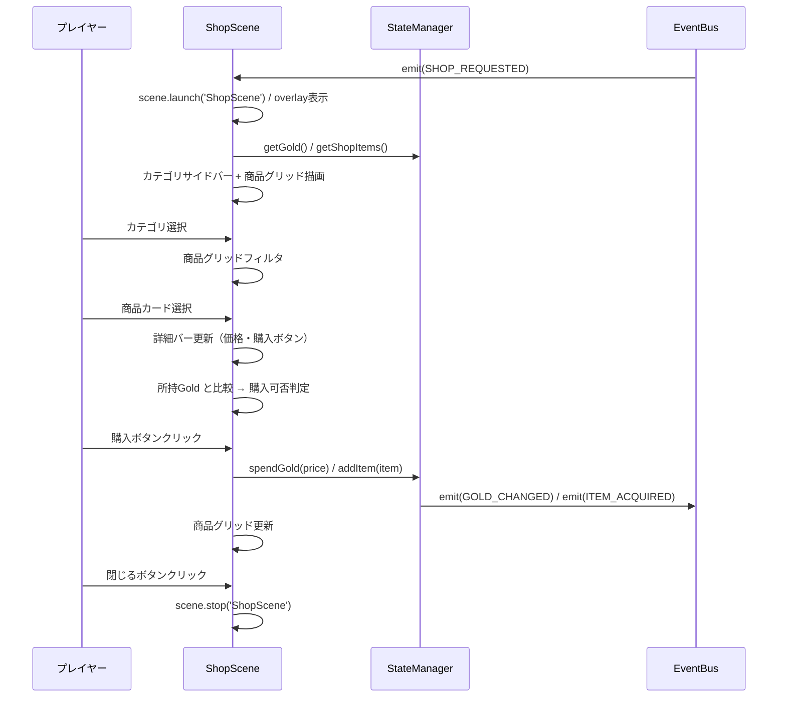
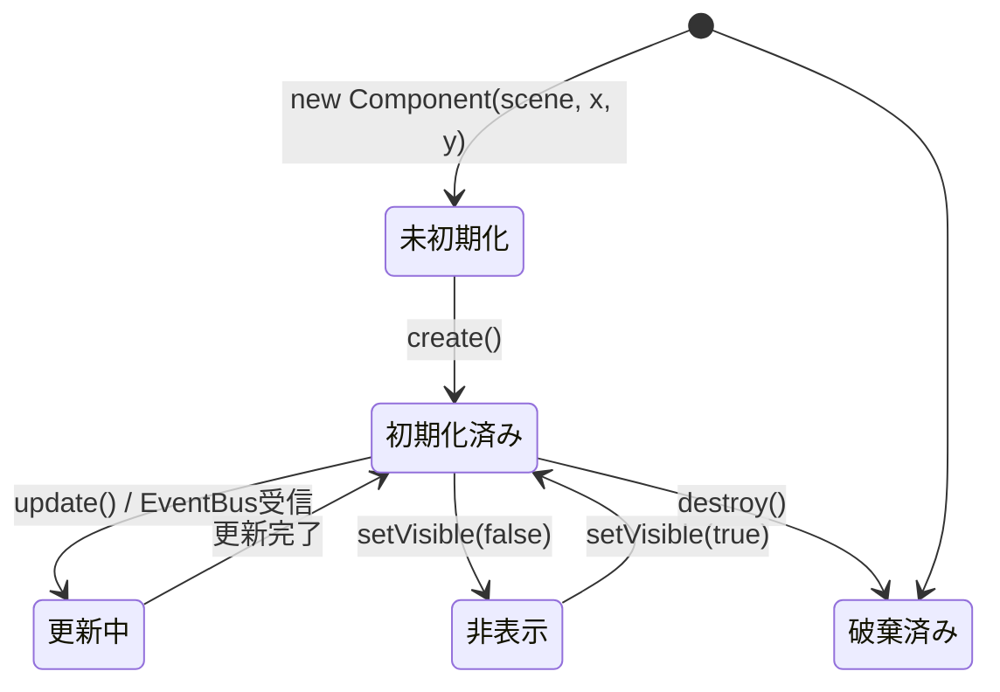

# UIモックアップ実装 データフロー図

**作成日**: 2026-06-17  
**関連アーキテクチャ**: [architecture.md](architecture.md)  
**関連モックアップ計画**: [mockup-implementation-plan.md](../atelier-guild-rank/ui-design/mockup-implementation-plan.md)

**【信頼性レベル凡例】**:
- 🔵 **青信号**: 既存実装・設計文書・モックアップを参考にした確実なフロー
- 🟡 **黄信号**: 既存実装・設計文書・モックアップから妥当な推測によるフロー
- 🔴 **赤信号**: 既存実装・設計文書・モックアップにない推測によるフロー

---

## フェーズ遷移フロー 🔵

**信頼性**: 🔵 *game-mechanics.md・state-management.md より*



---

## HUDBar データフロー 🔵

**信頼性**: 🔵 *既存 HUDBar 実装・state-management.md より*



**更新タイミング**:
- ゴールド変動時: `GameEventType.GOLD_CHANGED`
- AP変動時: `GameEventType.AP_CHANGED`
- 日数変動時: `GameEventType.DAY_ADVANCED`
- ランク変動時: `GameEventType.RANK_CHANGED`

---

## SidebarUI データフロー 🔵

**信頼性**: 🔵 *既存 SidebarUI・state-management.md より*



---

## PhaseRail（フェーズタブ）データフロー 🔵

**信頼性**: 🔵 *既存 PhaseRail・state-management.md より*



---

## QuestAcceptPhaseUI データフロー 🔵

**信頼性**: 🔵 *既存 QuestAcceptPhaseUI・モックアップ 02 より*



**UI状態遷移**:
```
未選択 → 選択（border-color: #B8A9D4 3px + チェックマーク）→ 受注済み（バッジ表示）
```

---

## DeliveryPhaseUI データフロー 🔵

**信頼性**: 🔵 *既存 DeliveryPhaseUI・モックアップ 05 より*



---

## TitleScene データフロー 🔵

**信頼性**: 🔵 *既存 TitleScene・モックアップ 01 より*



---

## GameClearScene データフロー 🔵

**信頼性**: 🔵 *既存 GameClearScene・モックアップ 06 より*



**統計項目の確定**（事前確認事項 B 解決済み）:
- 「もう一度挑戦」ボタンを実装する（TitleScene へ遷移）
- 統計項目はモックアップ 06 の 6 項目で実装する

---

## ShopScene データフロー 🔵

**信頼性**: 🔵 *既存 ShopScene・モックアップ 07 より*



---

## コンポーネントライフサイクル 🔵

**信頼性**: 🔵 *BaseComponent パターン・phaser-best-practices.md より*



**destroy() 必須チェックリスト**:
- [ ] EventBus 購読解除 (`unsubscribe?.()`)
- [ ] Tween 停止 (`this.scene.tweens.killTweensOf(target)`)
- [ ] タイマー削除 (`this.scene.time.removeAllEvents()`)
- [ ] コンテナ破棄 (`this.container.destroy(true)`)

---

## 関連文書

- **アーキテクチャ**: [architecture.md](architecture.md)
- **型定義**: [interfaces.ts](interfaces.ts)
- **ヒアリング記録**: [design-interview.md](design-interview.md)

---

## 信頼性レベルサマリー

- 🔵 青信号: 10件 (91%)
- 🟡 黄信号: 1件 (9%)
- 🔴 赤信号: 0件 (0%)

**品質評価**: ✅ 高品質
